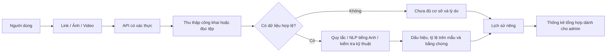

# Kiểm tra sản phẩm từ link, ảnh và video

## Trải nghiệm người dùng

Đăng nhập bằng tài khoản người dùng, mở Kiểm tra sản phẩm. Màn hình chính có Link sản phẩm, Tải ảnh, Tải video và phân tích Văn bản tiếng Anh có sẵn. Người dùng không thấy thống kê hệ thống hay menu mua hàng. Admin/kỹ sư có trang thống kê riêng về lượt kiểm tra, nguồn dữ liệu, nền tảng và tệp đã đọc; thống kê không chứa nội dung hoặc tài khoản của người khác trong kết quả trả về.

Link được nhận diện và chuẩn hóa; job chạy nền, giao diện theo dõi trạng thái, lưu 30 lần gần nhất theo tài khoản. Kết quả có thông tin sản phẩm nếu đọc được, dấu hiệu theo review, tỷ lệ trong mẫu, bằng chứng, giới hạn và tải JSON. Thời gian lưu UTC được chuyển theo múi giờ thiết bị.

## Thu thập từ ba sàn

- Shopee Việt Nam: trang công khai và endpoint review công khai khi nguồn cho phép. Endpoint có thể thay đổi hoặc từ chối truy cập; chưa phải tích hợp Open Platform có ủy quyền.
- TikTok Shop: đọc dữ liệu có cấu trúc trong trang công khai. Không vượt CAPTCHA hay đăng nhập; chưa có kết nối API seller có ủy quyền.
- Lazada Việt Nam: đọc Product/Review JSON-LD và metadata công khai khi có. Không tự biến rating tổng hợp thành review; chưa tích hợp API seller có ủy quyền.

Đã kiểm tra đúng ID của ba link người dùng gửi:

| Sàn | Product ID | Kết quả truy cập trong phiên |
|---|---|---|
| Shopee | 51200696506, shop 1556630007 | Nguồn từ chối truy cập review |
| TikTok Shop | 1730096415976294875 | Trang Security Check |
| Lazada | 13326005147 | Lấy được tên/mô tả; chưa có review công khai đọc được |

Đây không phải nhận định sản phẩm giả hay người bán có vấn đề. Không lấy được dữ liệu không đồng nghĩa review đáng ngờ. Để phân tích sâu hơn cần nguồn review được cấp quyền. Có nhập file JSON tối đa 200 review; phải ghi rõ đó là dữ liệu người dùng cung cấp, chưa xác minh với sàn. Mẫu tại frontend-web/public/review-import.example.json chỉ là dữ liệu tổng hợp minh họa.

Nguồn tham khảo khả năng tích hợp chính thức: [Lazada Product Review API](https://open.lazada.com/apps/doc/getting_started), [TikTok Shop app review và seller authorization](https://partner.tiktokshop.com/docv2/page/app-review-process), [Shopee Open Platform](https://open.shopee.com/). Các nguồn này không đảm bảo quyền đọc review của mọi sản phẩm bất kỳ.

## Cách đọc tỷ lệ

Tỷ lệ review có dấu hiệu = số review có ít nhất một dấu hiệu / số review quan sát được, sau bỏ bản ghi trùng ID. Dấu hiệu gồm văn bản rất ngắn, nội dung lặp, liên hệ ngoài, tham chiếu media lặp, tác giả lặp (khi có ID) và tín hiệu model tiếng Anh khi phù hợp. Mỗi dấu hiệu đều cần ngữ cảnh; không phải nhãn gian lận đã xác minh. Dưới 5 review đánh dấu chưa đủ cơ sở; 0 review không có phần trăm.

Nhận định về trải nghiệm sản phẩm được tổng hợp theo từ khóa Việt/Anh về chất lượng, kích thước, ngoại hình, giá, giao hàng/đóng gói, có trích đoạn và ID review. Bỏ nội dung trùng trước tổng hợp. Đây là quy tắc từ khóa, chưa phải mô hình sentiment đã đánh giá; có thể sai với phủ định, mỉa mai, ngữ cảnh và cần người dùng đọc bằng chứng.

NLP chỉ được gọi cho review khai báo en hoặc vượt bộ lọc tiếng Anh thận trọng. Review tiếng Việt không nhận xác suất từ model tiếng Anh. Model OR/CG không xác minh hàng chính hãng hoặc danh tính con người.

## Ảnh và video tải lên

Tối đa 6 tệp, mỗi tệp 40MB, tổng 60MB; video tối đa 5 phút. Kiểm tra chữ ký/giải mã thay vì tin đuôi file. Ảnh tối đa 20 triệu điểm ảnh; kiểm tra kích thước, SHA256, dHash. Video đọc tối đa 6 khung hình mẫu, không phân tích âm thanh. Video trong review từ link hiện chỉ kiểm tra tham chiếu URL trùng; chưa tải/giải mã video từ sàn.

Tỷ lệ media = số tệp có dấu hiệu kỹ thuật / số tệp gửi. Ảnh nhỏ hoặc trùng có thể hợp lệ; tỷ lệ không xác nhận ảnh/video giả. Chưa có deepfake detection, OCR, nhận diện AI-generated media hay so khớp ngữ nghĩa ảnh/video với mô tả sản phẩm.

Tệp gốc chỉ được xử lý tạm thời, không lưu vào lịch sử. Lịch sử lưu metadata, hash, dấu hiệu và kết quả; không lưu bytes ảnh/video. Không tạo dữ liệu giả khi nguồn thất bại. Các tài khoản chỉ đọc được lịch sử của mình. Chỉ tải media từ các CDN được cho phép; kiểm tra địa chỉ public và từng chuyển hướng để tránh SSRF.

## API

| Endpoint | Ý nghĩa |
|---|---|
| POST /api/product-links | Tạo job từ link, trả 202 |
| GET /api/product-links/{id} | Trạng thái/kết quả thuộc tài khoản |
| GET /api/product-links | 30 lần kiểm tra gần nhất của chính mình |
| POST /api/product-links/import | Phân tích review do người dùng cung cấp |
| POST /api/product-links/media | Multipart files, xử lý ảnh/video local |
| GET /api/product-links/admin/summary | Chỉ admin/kỹ sư, thống kê tổng hợp |

Bảng mới `product_link_analyses` được tạo bằng SQLAlchemy khi API khởi động; không xóa bảng hoặc dữ liệu cũ. Job đang chạy bị gián đoạn khi dừng API không tự tiếp tục; tạo lại yêu cầu khi cần. Worker bền vững, API có ủy quyền từng sàn, mô hình đa phương tiện/tiếng Việt và kiểm thử native vẫn là phần cần phát triển thêm.

