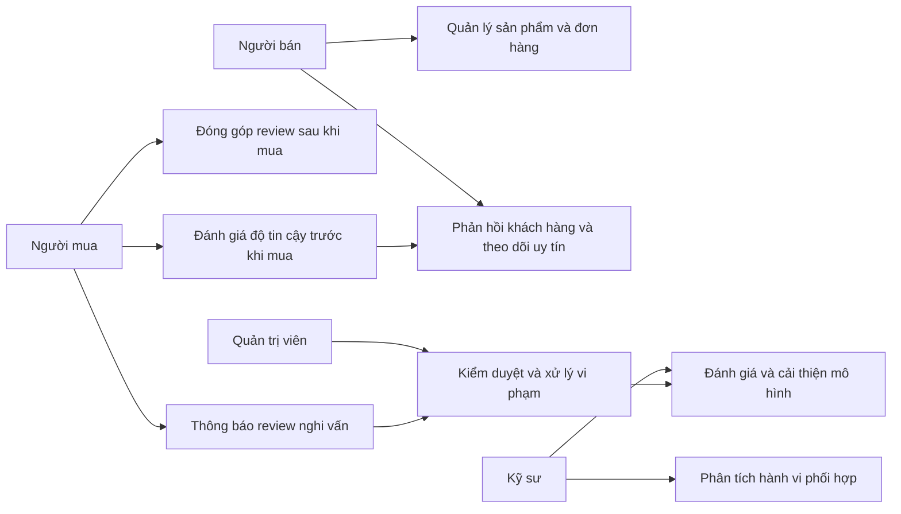
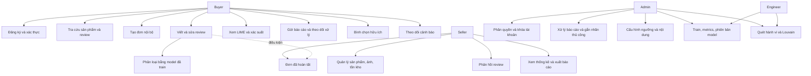
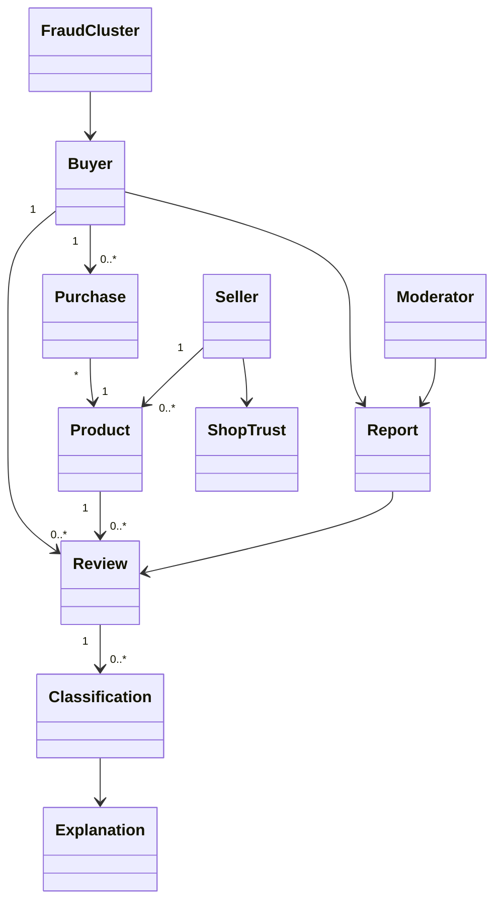
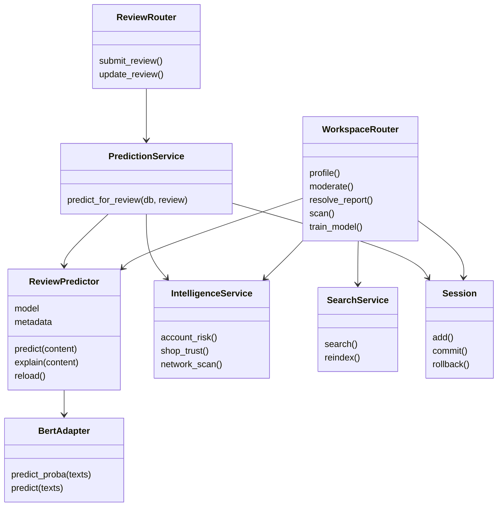
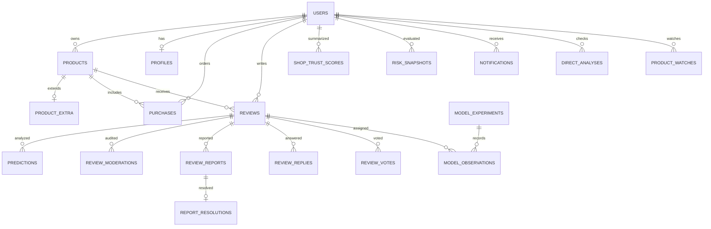
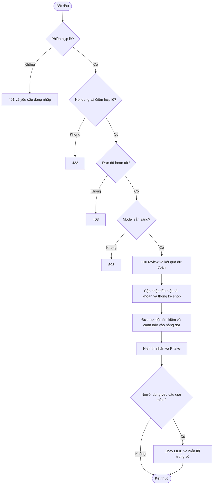
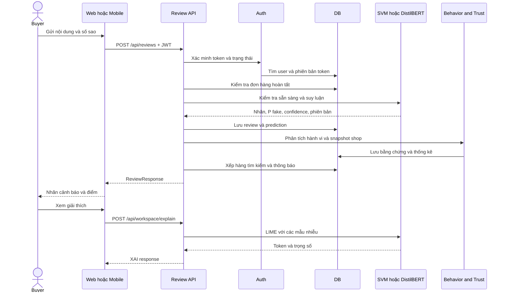

> Cập nhật phạm vi: luồng người dùng hiện tại là kiểm tra link/ảnh/video, không đặt mua hay quản lý tồn kho. Xem `LUONG_KIEM_TRA_SAN_PHAM.md`. Các phần mua bán trong tài liệu bên dưới mô tả phiên bản nghiệp vụ trước khi người dùng chốt lại ý tưởng.

# Phân tích và thiết kế hệ thống Fake Review Detection

Tài liệu mô tả bản nâng cấp trong thư mục này. Chức năng cần dịch vụ ngoài được đánh dấu trong phần cấu hình; dữ liệu demo không phải dữ liệu thật của sàn thương mại điện tử.

## 1. Use-case nghiệp vụ

## 2. Use-case hệ thống

## 3. Lớp phân tích

## 4. Lớp thiết kế

## 5. Mô hình dữ liệu

Ngoài các quan hệ trên còn có categories, fraud_clusters, system_settings, password_resets, external_identities, push_devices, notification_preferences, notification_outbox, search_events, training_jobs và site_content. Cụm tài khoản lưu danh sách thành viên và bằng chứng JSON; không tự động khóa tài khoản.

## 6. Activity Diagram khi viết review

## 7. Sequence Diagram

## 8. Đặc tả các use-case chính

| Mã | Use-case | Tác nhân | Điều kiện trước | Luồng chính | Ngoại lệ và kết quả |
|---|---|---|---|---|---|
| UC01 | Viết review | Buyer | Đăng nhập, đơn hoàn tất, sản phẩm tồn tại | Nhập văn bản 1–5000 ký tự và 1–5 sao; API gọi model, lưu review/prediction và trả kết quả | Chưa mua: 403; rỗng: 422; chưa có model: 503. Review ngắn vẫn được tiếp nhận để phân tích hành vi. |
| UC02 | Phân loại AI | Người dùng | Model đã train được nạp | Dùng preprocessing trong pipeline, suy luận, hiển thị P(fake), confidence và phiên bản | Không dùng kết quả luật tạm thay model thật; nội dung ngoài miền dữ liệu cần ghi rõ giới hạn. |
| UC03 | Xem cảnh báo và LIME | Người dùng | Có review hoặc văn bản cần kiểm tra; đăng nhập để gọi XAI | Gửi văn bản, LIME tạo 500 mẫu, trả 10 token quan trọng và mức đóng góp | Nếu đổi phiên bản model, cần đối chiếu phiên bản dùng để giải thích với kết quả gốc. Không coi từ khóa là bằng chứng chắc chắn. |
| UC04 | Báo cáo vi phạm | Buyer/seller | Đăng nhập, review tồn tại | Chọn lý do, mô tả; tạo report pending; theo dõi tại danh sách report của mình | Mỗi tài khoản chỉ báo cáo một lần cho một review; trùng: 409. |
| UC05 | Xử lý báo cáo | Admin | Có báo cáo | Đọc bằng chứng, chọn trạng thái, ghi lý do; lưu phản hồi và thông báo | Buyer/seller không được xử lý; engineer chỉ xem. Nhãn thủ công được lưu riêng với dự đoán AI. |
| UC06 | Phân tích hành vi | Admin/engineer | Có review gắn tài khoản/sản phẩm/thời gian | Kiểm tra độ ngắn, trùng nội dung đa sản phẩm, mật độ review và từ khóa cấu hình; tính tỷ lệ | 0 review: chưa đủ dữ liệu; không tự khóa tài khoản; ngưỡng 50 và 70 không chồng nhau. |
| UC07 | Phân tích mạng lưới | Admin/engineer | Có quan hệ tài khoản–sản phẩm | Tìm cặp có dấu hiệu phối hợp trên ≥2 sản phẩm, chạy Louvain seed42, lưu thành viên và bằng chứng | Không coi mọi cộng đồng là gian lận; dataset CSV OR/CG không có đủ quan hệ cho đánh giá mạng. |
| UC08 | Theo dõi uy tín shop | Buyer/seller | Có dữ liệu review | Tổng hợp nhãn hiện hành, tỷ lệ theo ngày review, snapshot theo ngày tính và số sao sau lọc | Review chưa phân loại tách riêng; không có dữ liệu thì điểm null, không gán mặc định 100. |
| UC09 | Quản lý mô hình | Admin/engineer | Có dataset và môi trường train | Tạo job, xem log và metrics, admin chọn phiên bản; giữ kết quả nghiên cứu | Job lỗi ghi failed, không báo hoàn thành; không nhận đường dẫn artifact tùy ý ngoài thư mục models. |
| UC10 | Thí nghiệm A/B | Admin | Hai artifact hợp lệ | Chọn hai model, tỷ lệ B; gán biến thể ổn định theo tài khoản; ghi kết quả và latency | Tỷ lệ đồng thuận với moderator chỉ tính khi có nhãn kiểm duyệt; không gọi là accuracy trên ground truth độc lập. |
| UC11 | Tìm kiếm nâng cao | Người dùng | Elasticsearch chạy và có index | Worker hoặc admin đồng bộ index; tìm sản phẩm/review và lọc nhãn | Elasticsearch lỗi: trả 503 rõ ràng; trang sản phẩm vẫn có SQL search cơ bản. |
| UC12 | Đổi và khôi phục mật khẩu | Người dùng | Có tài khoản | Xác nhận mật khẩu cũ hoặc token khôi phục 15 phút; lưu hash mới, tăng token_version | Token sai/hết hạn/tái sử dụng bị từ chối; gửi email cần cấu hình SMTP và worker. |

## 9. Nguyên tắc phân biệt ba loại điểm

1. **P(fake)**: đầu ra phân loại văn bản; SVM được hiệu chuẩn trên tập train, DistilBERT dùng softmax và chưa tuyên bố đã hiệu chuẩn.
2. **Confidence của nhãn**: max(P(fake), P(real)); không dùng thay tỷ lệ gian lận tài khoản.
3. **Rủi ro tài khoản**: số review có ít nhất một dấu hiệu hành vi / tổng review ×100. Mặc định ≤50 bình thường, >50 và <70 nghi vấn, ≥70 đáng ngờ.

Độ uy tín shop là chỉ số tổng hợp từ review đã phân loại hoặc kiểm duyệt; nó không xác nhận chất lượng thật của shop và cần xem cùng số lượng mẫu.
